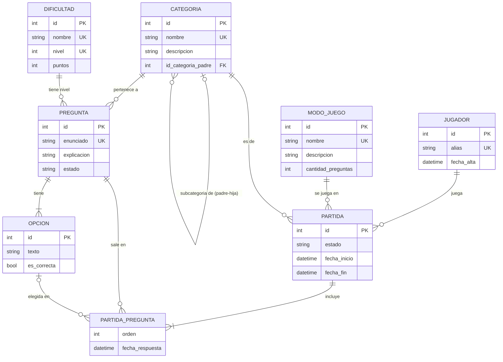

# Hito 1 — Idea, reglas y MER

> Borrador de trabajo del grupo Sala 5. Antes de entregar: revisarlo juntos, redibujar el MER en Miro (con la notación de la cátedra) y pasarlo a PDF.

## 1. Descripción del juego

**Nombre:** Desafío Sala 5

**Objetivo.** Responder correctamente la mayor cantidad de preguntas de una partida para sumar puntos y quedar arriba en el ranking del grupo.

**Cómo se juega.**

1. El jugador ingresa con un **alias** (si es nuevo, se registra).
2. Elige un **modo de juego**, que define cuántas preguntas tiene la partida:
   - Relámpago: 5 preguntas.
   - Clásico: 10 preguntas.
   - Maratón: 15 preguntas.
3. Elige una **categoría**. Las categorías forman un árbol: por ejemplo *Informática › Bases de datos › SQL*. Si elige "Informática", pueden salir preguntas de Informática y de todas sus subcategorías.
4. La base sortea las preguntas **activas** de esa rama, sin repetir, y les asigna un orden.
5. Cada pregunta tiene varias opciones y **una sola correcta**. El jugador elige una; ya no puede cambiarla.
6. Después de cada respuesta ve si acertó, cuál era la correcta y una explicación breve.

**Cómo se gana o termina.** La partida **termina** cuando se responden todas sus preguntas. El puntaje es la suma de los puntos de cada acierto según la dificultad (Fácil 10, Media 20, Difícil 30). Según el porcentaje de aciertos se obtiene medalla de oro (≥ 80 %), plata (≥ 60 %) o bronce (≥ 40 %). Las partidas terminadas entran al **ranking**: gana el mayor puntaje y, si hay empate, quien terminó más rápido.

**Contenido.** Las preguntas se cargan primero como **borrador** y pasan a **activas** cuando están completas; solo las activas salen en las partidas.

## 2. Reglas del juego

Las marcadas con **[BASE]** se imponen en la base de datos (no solo en la aplicación).

1. **[BASE]** Una misma pregunta no puede aparecer dos veces en una partida.
2. **[BASE]** Cada pregunta de una partida se responde una sola vez, y solo mientras la partida está en curso.
3. **[BASE]** La opción elegida tiene que ser una de las opciones de esa pregunta.
4. **[BASE]** Una pregunta activa tiene al menos 2 opciones y exactamente una correcta. Mientras está activa, sus opciones no se pueden modificar.
5. **[BASE]** Una partida tiene exactamente la cantidad de preguntas que indica su modo de juego, y solo pueden salir preguntas activas.
6. **[BASE]** Una partida solo se puede finalizar cuando todas sus preguntas fueron respondidas; una partida finalizada no se modifica.
7. **[BASE]** El puntaje de una partida se calcula solo a partir de las respuestas registradas y los puntos de cada dificultad (no se carga a mano).
8. **[BASE]** Iniciar una partida es una acción atómica: se crea la partida con todas sus preguntas o no se crea nada.
9. **[BASE]** El alias de un jugador es único y tiene al menos 3 caracteres.
10. Las preguntas de la partida se toman de la categoría elegida y de todas sus subcategorías.
11. A igual puntaje, en el ranking queda primero quien terminó la partida en menos tiempo.

## 3. Modelo Entidad-Relación

### Entidades y atributos

| Entidad | Atributos (PK subrayada en el diagrama) |
|---|---|
| JUGADOR | id, alias (único), fecha_alta |
| CATEGORIA | id, nombre (único), descripción |
| DIFICULTAD | id, nombre (único), nivel (único), puntos |
| MODO_JUEGO | id, nombre (único), descripción, cantidad_preguntas |
| PREGUNTA | id, enunciado (único), explicación, estado |
| OPCION | id, texto, es_correcta |
| PARTIDA | id, estado, fecha_inicio, fecha_fin |

### Relaciones

| Relación | Entidades | Cardinalidad | Atributos propios |
|---|---|---|---|
| **subcategoría de** (reflexiva) | CATEGORIA (hija) – CATEGORIA (padre) | N : 1 (una categoría tiene 0 o 1 padre; un padre tiene 0..N hijas) | — |
| pertenece a | PREGUNTA – CATEGORIA | N : 1 | — |
| tiene nivel | PREGUNTA – DIFICULTAD | N : 1 | — |
| tiene | PREGUNTA – OPCION | 1 : N (OPCION depende de su pregunta) | — |
| juega | JUGADOR – PARTIDA | 1 : N | — |
| se juega en | PARTIDA – MODO_JUEGO | N : 1 | — |
| es de | PARTIDA – CATEGORIA | N : 1 | — |
| **incluye** (N:M con atributos) | PARTIDA – PREGUNTA | N : M | orden, opción elegida, fecha de respuesta |
| elige | (PARTIDA–PREGUNTA) – OPCION | N : 1, opcional (0 hasta que se responde) | — |

Requisitos de la consigna:

- **N:M con atributos propios:** *incluye* (PARTIDA–PREGUNTA) con orden, opción elegida y fecha de respuesta.
- **Estructura avanzada:** relación **reflexiva** *subcategoría de* en CATEGORIA, con dos roles (padre e hija). Se usa de verdad en el juego: al elegir una categoría se juegan también sus subcategorías.
- **Final alcanzable:** la partida termina al responder todas las preguntas de su modo.

### Diagrama (versión de referencia)

GitHub dibuja este diagrama automáticamente. Para la entrega, rehacerlo en Miro con la notación de clase (rectángulos, rombos y óvalos).

### Alcance (MVP) y mejoras futuras

Entra en el MVP: registro por alias, 3 modos, categorías jerárquicas, partidas individuales, devolución por pregunta, resultado y ranking.

Queda como mejora futura: límite de tiempo por pregunta, torneos por fases entre jugadores, partidas multijugador en simultáneo, panel web para cargar preguntas, comodines (50/50).
